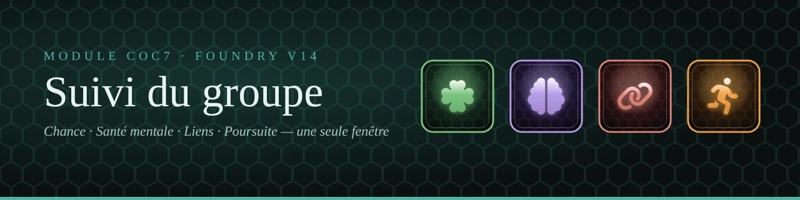

<p align="center"></p>

<h1 align="center">CoC7 — Suivi du groupe</h1>

<p align="center">
  <strong>Tes quatre suivis CoC7 dans une seule fenêtre à onglets : Chance, Santé Mentale, Liens, Poursuite</strong><br>
  L'Appel de Cthulhu (CoC7) · Foundry VTT v14
</p>

---

## En bref

Un seul bouton (Gardien) dans les contrôles des jetons ouvre le **Suivi du groupe**. Chaque onglet est la fenêtre d'origine du module correspondant, avec toutes ses fonctions :

| Onglet | Module d'origine | Ce qu'on y retrouve |
|---|---|---|
| 🍀 **Chance** | Suivi de Chance du groupe | Chance de chaque investigateur par époque, la plus basse repérée, choix de l'époque de chacun |
| 🧠 **Santé mentale** | Suivi de Santé Mentale du groupe | SAN et SAN max, seuil de folie indéfinie, l'investigateur le plus fragile |
| 🔗 **Liens** | Suivi des Bonds du groupe | Ajouter, rompre, supprimer les liens de chaque investigateur |
| 🏃 **Poursuite** | Suivi de Poursuites | À pied ou en voiture, glisser-déposer des participants, conducteurs, jauge d'écart, jet de Chance, obstacles, journal |

Le filtre d'époque (1933 / 2025-2026 / les deux) est commun aux onglets Chance, Santé mentale et Liens, et la **Bascule d'époque** le règle toute seule.

Le bouton **jauge de poursuite** reste disponible pour tous les joueurs.

## Tes données sont gardées

Le module lit et écrit aux mêmes endroits que les quatre anciens modules : l'époque de chaque investigateur, ses liens et la poursuite en cours sont là dès l'ouverture.

Désactive ensuite **Suivi de Chance**, **Suivi de Santé Mentale**, **Suivi des Bonds** et **Suivi de Poursuites** : un message le rappelle au Gardien tant que l'un d'eux est actif. Tu peux même les désinstaller, les données restent sur les fiches.

## Macro

```js
game.modules.get("coc7-suivi-groupe").api.ouvrir("san")   // "chance", "san", "liens", "poursuite"
```

## Installation

Dans Foundry : **Modules › Installer un module**, puis colle l'adresse du manifeste :

```
https://github.com/magisterphamtom/coc7-suivi-groupe/releases/latest/download/module.json
```

**Configuration requise** : Foundry VTT v14, système CoC7 8.14 ou plus.

## Licence

Code sous licence MIT. Les idées d'obstacles de la poursuite sont originales, ce n'est pas la table officielle d'un manuel.
